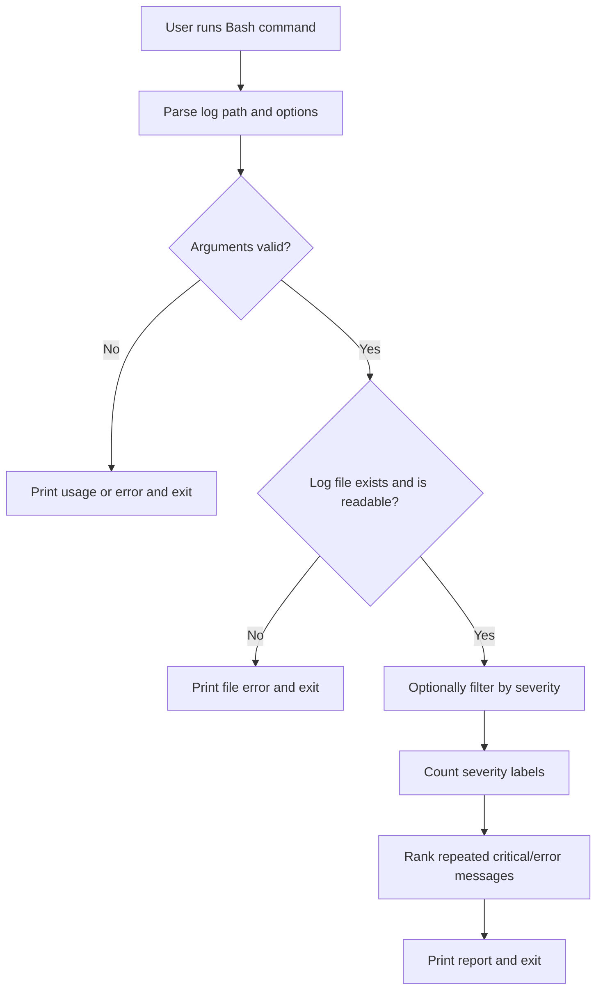

# Linux Log Analyzer

> `linux-log-analyzer` — summarizes severity levels in a text log and highlights repeated error messages using Bash and standard Linux command-line utilities.

**Team:** Param Gala, Shreya  
**Repository:** Add your GitHub repository URL after creating the repository  
**Date:** 29-10-2026

---

## 1. The problem

### What we keep doing by hand

When checking a log, we may search for errors, count severity labels, and find repeated messages using separate commands. This project combines those steps into one Bash command. Confirm or replace this description with the exact workflow you personally repeat.

```bash
grep -i "ERROR" sample.log
grep -ic "ERROR" sample.log
grep -iE "CRITICAL|ERROR" sample.log | sort | uniq -c | sort -nr
```

### Evidence that this is real

Run this on your own Linux machine and paste the real output below. Do not present a made-up number as personal evidence.

```bash
history | grep -E 'grep|journalctl|/var/log' | wc -l
```

**Your real output:** `[Paste your actual output here.]`

How often does this happen, and what does it cost each time?  
`[Write two sentences based on your own experience.]`

### Who else has this problem

People who inspect logs during Linux administration, development, or debugging may need similar searches. Ask a classmate or teammate and add their name and actual response: `[Person and response, or state that you have not asked anyone yet.]`

---

## 2. Prior art — what already exists

### Tools to investigate and actually try

Do not claim these were installed or tested until you have run them and recorded the real output.

| Tool | Where we found it | What it does | Why it may not solve this exact workflow |
|---|---|---|---|
| `grep` | `man grep` | Searches text for patterns | Search alone does not provide a combined severity summary and ranked repeated-error report |
| `awk` | `man awk` | Processes text records and fields | Requires a suitable script or pipeline to combine the desired steps |
| `journalctl` | `man journalctl` | Reads systemd journal entries | Focuses on the systemd journal rather than every arbitrary text log file |
| `lnav` | [lnav.org](https://lnav.org/) | Interactive log viewer and analyzer | Test it against your exact workflow before deciding what is missing |

### Evidence of trying them

Run at least three tools or commands and record the exact output from your own Linux machine.

```bash
grep --version
awk --version
journalctl --version
```

If `awk --version` is unsupported, record that message and consult `man awk` or `awk -W version` where supported.

**Command actually run:** `[Paste one exact command here]`

**Real output:**
```text
[Paste the output from your own terminal here.]
```

**What it got right and what was missing:** `[Describe what you observed. Do not claim a tool was tested until you have tested it.]`

### Where we searched

Mark each item only after doing it.

- [ ] `man -k log`, `man grep`, or other relevant manual-page searches
- [ ] GitHub search for log analyzer shell scripts
- [ ] Package manager search, such as `apt search lnav` or your distribution's equivalent
- [ ] Stack Overflow search for the specific log-inspection workflow
- [ ] Relevant package/project documentation
- [ ] Asked a human: `[who and what they said, or note not yet done]`

### The gap, in one sentence

> Existing tools provide text search, log viewing, or text processing, but this project aims to combine severity counts, severity filtering, and repeated-error ranking for a plain-text log in one small Bash command.

This is the proposed gap, not a claim that no existing tool can do the same thing. Revise it after completing the prior-art tests.

---

## 3. What we are building

### In scope

- Read a user-supplied, readable plain-text log file.
- Count `CRITICAL`, `ERROR`, `WARNING`, `INFO`, and `DEBUG` labels.
- Optionally filter the input by severity using `--level`.
- Show frequent messages containing `CRITICAL` or `ERROR`, with a configurable maximum using `--top`.
- Print useful errors for missing files or invalid options.

### Out of scope

- Automatically modifying or deleting log files.
- Replacing a full-featured interactive log viewer.
- Parsing every possible log format.
- Reading protected system logs without permission.

### How we will know it worked

> The tool is successful if it turns repetitive search/count/rank commands into one command, produces expected results for the sample log, handles invalid input clearly, and remains useful after the assignment.

---

## 4. Tech stack

| Choice | What we picked | Why, and what we rejected |
|---|---|---|
| Language | Bash shell script | Fits a Linux command-line assignment and uses standard utilities; Python would make the project less focused on shell scripting |
| Argument parsing | Bash `case` statement | Simple for `--level` and `--top`; no external parser needed |
| Other dependencies | `grep`, `sed`, `sort`, `uniq`, `awk`, `wc`, `head`, `mktemp` | Standard text-processing utilities; no third-party runtime library required |
| Testing | Bash smoke-test script | Tests core behavior without a larger test framework |
| Packaging / install method | Clone/copy folder and run with Bash | Simple setup; system-wide packaging is outside scope |

### Why this language

Bash fits because the assignment is Linux-focused and the task combines standard command-line utilities. A pipeline can search, group, count, and format log lines without another application runtime. The goal is to demonstrate shell scripting and Linux text processing, not to build a general-purpose log-analysis application.

### What we are deliberately not using

Python is not the main implementation because the goal is to demonstrate Linux shell scripting. No database, network service, or third-party package is added because the tool processes a local text file.

---

## 5. Architecture



### Components

| Part | Responsibility | File |
|---|---|---|
| CLI and validation | Parse options, validate input, handle errors | `linux_log_analyzer.sh` |
| Log input | Example text records for repeatable tests | `sample.log` |
| Smoke tests | Check summary, filtering, top-N, and missing-file behavior | `tests/test_linux_log_analyzer.sh` |
| Documentation | Explain setup, commands, and design | `README.md` |

### Data flow

The user provides a plain-text log path and optional flags. The script validates the path and options, optionally filters lines by severity, then uses standard text-processing commands to count labels and rank repeated error messages. The report is printed to standard output; the original log is not changed.

### What happens when things go wrong

| If this happens | The tool does this |
|---|---|
| Log file does not exist | Prints `Error: log file not found: ...` and exits with code `1` |
| File is not readable | Prints a file-access error and exits with code `1` |
| Unknown option or invalid severity | Prints an error/usage message and exits with code `2` |
| `--top` is not a positive integer | Prints a validation error and exits with code `2` |

---

## 6. Usage

### Synopsis

```text
./linux_log_analyzer.sh <log-file> [--level LEVEL] [--top N]
```

### Commands and flags

| Short form | Long form | What it does | Default |
|---|---|---|---|
| — | `--help` | Show usage information | — |
| — | `--level LEVEL` | Filter to `CRITICAL`, `ERROR`, `WARNING`, `INFO`, or `DEBUG` | No filtering |
| — | `--top N` | Show up to N repeated critical/error messages | `5` |

### Examples

These are sample results from the included log; run them on your own Linux machine before using them as personal evidence.

**Basic use**
```bash
./linux_log_analyzer.sh sample.log
```

Expected sample output:
```text
Linux Log Analyzer
==================
Log file: sample.log
Lines analyzed: 11

Severity counts:
  CRITICAL: 1
  ERROR:   4
  WARNING: 2
  INFO:    3
  DEBUG:   1

Top error messages (up to 5):
  1. Connection timed out (3)
  2. Database unavailable (2)
```

**With a flag**
```bash
./linux_log_analyzer.sh sample.log --level ERROR
```

Expected sample result includes:
```text
Log file: sample.log
Lines analyzed: 4
```

**When it fails**
```bash
./linux_log_analyzer.sh missing-file.log
```

Expected error:
```text
Error: log file not found: missing-file.log
```

### Exit codes

| Code | Meaning |
|---|---|
| `0` | Command completed successfully |
| `1` | File missing or not readable |
| `2` | Invalid usage, option, severity, or `--top` value |

### Installation

```bash
git clone <your-repository-url>
cd <your-repository-folder>
chmod +x linux_log_analyzer.sh
./linux_log_analyzer.sh sample.log
bash tests/test_linux_log_analyzer.sh
```

Replace repository placeholders after publishing. Alternatively, extract the ZIP and run commands from that folder.

---

## 7. References

- [GNU Grep manual](https://www.gnu.org/software/grep/manual/grep.html) — searching and matching text.
- [GNU Awk manual](https://www.gnu.org/software/gawk/manual/gawk.html) — text processing and formatted output.
- [GNU Coreutils manual](https://www.gnu.org/software/coreutils/manual/coreutils.html) — utilities such as `head` and `wc`.
- [lnav project site](https://lnav.org/) — an existing log viewer to investigate and compare.
- Linux manual pages for `sort`, `uniq`, `sed`, `grep`, `awk`, and `journalctl` — consult your installed versions and record what you actually tried.

---

## Submission checklist

- [ ] Add your real repository URL.
- [ ] Add real output from a command run on your own machine in Section 1.
- [ ] Try at least three existing tools/commands and record real outputs in Section 2.
- [ ] Complete the search checklist based on actions actually performed.
- [ ] Capture your own terminal screenshots if required.
- [ ] Run `bash tests/test_linux_log_analyzer.sh` on your Linux machine.
